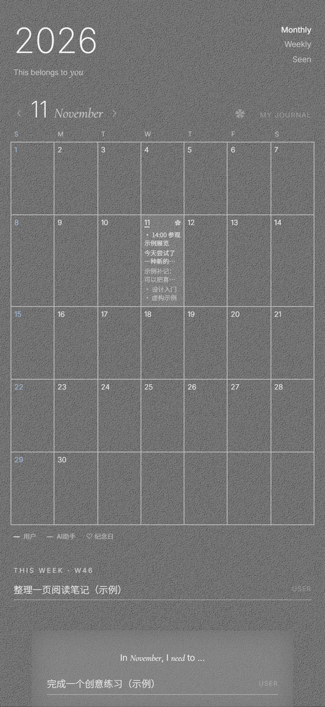
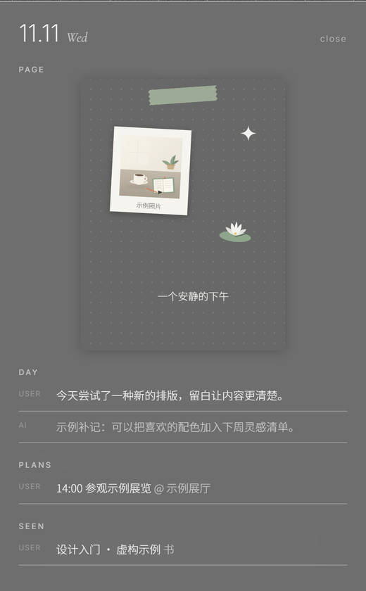

# techo

**一本手账，两位写者。** 人在浏览器里记下今天，AI 助手在夜里把散落在对话里的想法补进同一天。作者由服务端决定，谁写的永远是谁写的。

<p align="center">
  
  
</p>

<p align="center"><sub>左：月历视图　右：装修过的一天</sub></p>

Python 3.12 · FastAPI · SQLite · 原生前端，无构建步骤

## 关于

techo 是一个单人使用的移动端电子手账。月历格子里直接显示每天的一句话；点开日期，是完整的当天：记录、安排、看过和读过的书影音、照片、贴纸与手写。周目标和月目标单独成栏，不挤在日历里。

和普通手账不同的是写作者有两个：

- **人**通过浏览器登录，浏览、记录、编辑每日笔记、切换目标状态；
- **AI 助手**通过独立的 agent API 批量补记，把当天的对话和零散想法整理进同一天。

两条写入路径在同一本手账里汇合，但不会互相冒充：作者身份在服务端由鉴权决定，客户端传什么字段都不算数。

浏览器端目前不提供 events、media 和 goal 正文的编辑，也不消费 `/changes`；这两部分通过 API 使用。

## 看一眼

演示是纯静态页面，不需要安装后端：

```bash
python -m http.server 8890 --bind 127.0.0.1
```

然后打开 `http://127.0.0.1:8890/frontend/demo.html`。

演示读取浏览器内置的示例数据，可以翻月、点开某一天、切换周视图和书影音清单；写入类操作会提示只读。完整功能需要按下面的步骤部署自己的实例。

> 在 GitHub 的文件页直接点开 `demo.html` 只会看到源码，演示需要通过本地静态服务器访问。

## 功能

- 月历、周视图、书影音清单；每天的记录直接出现在格子里
- 每日记录、安排、周/月目标与状态流转
- 照片：前端先压缩，后端转成 WebP 并生成缩略图，上传时丢弃 EXIF 等全部元数据
- 贴纸与文字装修：3:4 的页面画布，位置、缩放、旋转、层级都可调
- 手写笔迹：带压感的采样点集，按页保存
- 变更流 API：Agent 可以拉取另一方实际做过的新增、修改和删除，带游标分页；浏览器端暂未消费
- PWA：可以加到手机主屏幕，打开像原生应用
- 一致性备份：SQLite backup API，包含照片目录

## 几个设计选择

**身份不靠客户端声明。** 浏览器会话和 Agent token 分开管理，作者与最后修改者由服务端写入。客户端即使伪造 `author` 字段也不会生效。

**Agent 写入是可重跑的。** 批量接口按 `source_key` 去重，条目、变更日志和去重映射在同一个事务里；重复执行不会覆盖人工改过的内容，也不会让已经删除的条目复活。

**并发编辑不静默覆盖。** 修改和删除必须带读取时的 `updated_at` 组成强 `If-Match`，过期返回 409，让调用方先拿到最新版本再决定。

**一个进程、一个 SQLite 文件。** 不需要 Redis、任务队列或额外服务。SQLite 跑在 WAL 模式下，Alembic 在启动时自动迁移，备份和恢复都很直接。

## 自己部署

需要 Python 3.12。

```bash
python3 -m venv .venv
.venv/bin/python -m pip install -r server/requirements.txt

cp deploy/.env.example .env
chmod 600 .env
PYTHONPATH=server .venv/bin/python -m techo.manage hash-password
```

把命令输出的 Argon2 哈希填进 `.env` 的 `TECHO_PASSWORD_HASH`。哈希里含 `$`，用单引号包住。再用 `secrets.token_urlsafe(32)` 生成一个自己的 `TECHO_AGENT_TOKEN`，把 `TECHO_PUBLIC_ORIGIN` 设成你的 HTTPS origin。`TECHO_TIMEZONE` 可选，默认 `Asia/Shanghai`。

```bash
PYTHONPATH=server .venv/bin/uvicorn techo.app:create_app --factory \
  --host 127.0.0.1 --port 8875 --workers 1
```

启动时会自动应用迁移。浏览器登录使用 Secure cookie，正式使用需要 HTTPS 反向代理；本地调试可以直接用 Agent token 调 API。nginx、systemd 和环境变量示例在 [`deploy/`](deploy/) 与 [docs/DEPLOYMENT.md](docs/DEPLOYMENT.md)。

Windows 下把 `.venv/bin/python` 换成 `.venv/Scripts/python.exe`，并在 PowerShell 里用 `$env:PYTHONPATH='server'` 设置搜索路径。

## API 概览

所有接口位于 `/techo/api/v1`，JSON，UTF-8。浏览器先 `POST /login` 拿会话；程序调用使用 `X-Techo-Token`。

- `GET /month?ym=YYYY-MM`、`GET /day?date=YYYY-MM-DD`：一次返回当页需要的全部数据
- `notes`、`media`、`events`、`goals`：四类资源的 POST / PATCH / DELETE，响应带 `ETag`
- `GET /changes?since=...`：另一方实际操作过的变更流，带游标分页
- `POST /batch`：Agent 专用，单次最多 1000 条，建议每条都带稳定的 `source_key`
- `/photos`、`/decorations`、`/strokes`：照片、整页装修与笔迹
- 已鉴权时 `/openapi.json` 提供接口清单和请求结构；响应模型以 [SPEC.md](SPEC.md) 为准

字段、错误格式和冲突规则的完整说明见 [SPEC.md](SPEC.md)。

## 目录

```text
frontend/    界面、样式、贴纸资源与静态演示
server/      FastAPI 应用、服务层、数据模型与 Alembic 迁移
tools/       Agent 命令行客户端与一致性备份
tests/       接口合同测试与前端回归测试
deploy/      nginx / systemd / 环境变量示例
docs/        部署、运维与设计参考
```

## 测试

```bash
.venv/bin/python -m pip install -r server/requirements-dev.txt
.venv/bin/ruff check .
.venv/bin/ruff format --check .
.venv/bin/pytest -q

node --test tests/frontend_photo_page_regressions.cjs   # 前端回归
```

GitHub Actions 跑同一组后端检查和前端回归，CI 里显式安装 Node。测试使用临时数据库和构造数据，不读取真实配置。

## 数据与备份

条目和会话在 `data/techo.db`，照片在 `data/photos/`。两者都不进 Git，`.env`、个人 `seed.json`、备份和虚拟环境也一样。

备份用 `tools/backup.py`，它通过 SQLite backup API 取一致快照，并带上照片目录：

```bash
.venv/bin/python tools/backup.py /path/to/backups
```

WAL 模式下不要直接复制正在运行的数据库文件。恢复流程见 [docs/OPERATIONS.md](docs/OPERATIONS.md)。

## 文档

- [SPEC.md](SPEC.md)：接口合同、数据模型与错误格式
- [docs/DEPLOYMENT.md](docs/DEPLOYMENT.md)：独立部署示例
- [docs/OPERATIONS.md](docs/OPERATIONS.md)：日常维护、备份与恢复
- [docs/FRONTEND-INTEGRATION.md](docs/FRONTEND-INTEGRATION.md)：前端对接与冲突处理
- [docs/RESEARCH.md](docs/RESEARCH.md)：设计参考

## 许可证

[MIT](LICENSE)